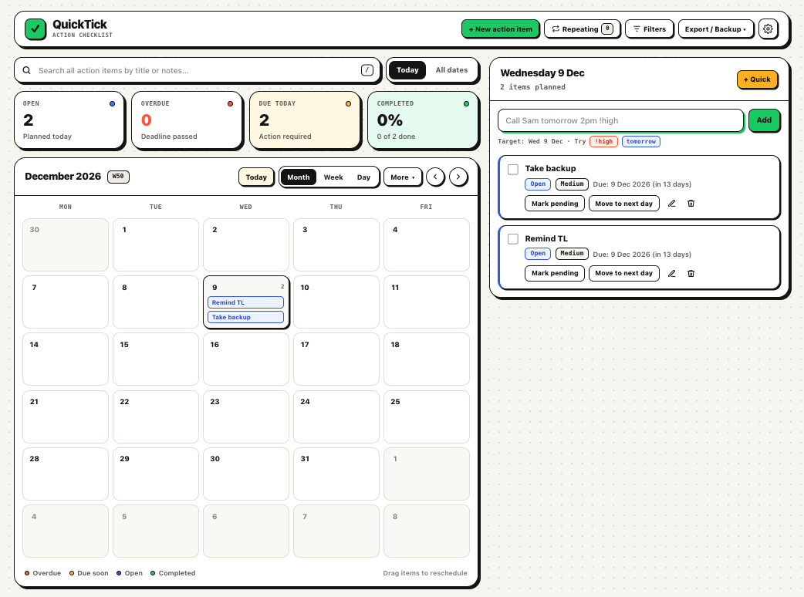
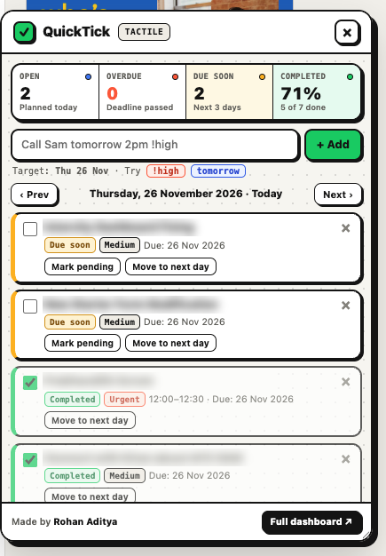

# QuickTick: Action Checklist (v3.1.0)

QuickTick is a Chrome / Edge extension for capturing, planning and tracking daily action items without leaving the browser. It pairs a floating checklist for quick capture with a full calendar dashboard for planning ahead.

## Features

### Floating checklist
- Opens on any normal web page from the toolbar icon, draggable and resizable
- At-a-glance stats: open, overdue, due soon and completion rate
- Natural-language quick add, e.g. `Call Sam tomorrow 2pm !high`
- Previous / next day navigation
- Priority and status tags (Urgent, High, Medium, Low, Due soon, Overdue, Completed)
- One-click actions to mark items pending or move them to the next day
- On a new-tab page the icon opens a small QuickTick window instead

### Full dashboard
- Calendar with month, week, work-week and day views
- Drag and drop to reschedule items
- Search across all action items by title or notes, for today or all dates
- Filters, plus CSV export of all or filtered items
- Repeating action items (daily, weekdays, weekly, monthly) with a series manager
- Day panel to add, edit and delete items for any date
- Light, dark and system themes
- JSON backup and restore, with an optional reminder to back up every 7 days

### Background
- Toolbar badge showing today's open plus overdue items (turns red when something is overdue)
- Desktop reminders before timed action items, with a configurable lead time

## Quick add syntax

| Type | Examples |
| --- | --- |
| Date | `today`, `tomorrow`, `day after tomorrow`, `next week`, `in 3 days`, `friday`, `next mon`, `12 Dec`, `2026-12-12` |
| Deadline | `by friday`, `due 15 Dec` |
| Time | `2pm`, `14:30`, `at 9`, `noon`, `10am-11:30am` |
| Priority | `!urgent`, `!high`, `!medium`, `!low`, `!1` to `!4`, `p1` to `p4` |

## Keyboard shortcuts (dashboard)

| Key | Action |
| --- | --- |
| `n` | New action item |
| `a` | Focus quick add |
| `/` | Search |
| `t` | Go to today |
| `[` / `]` | Previous / next period |
| `d` / `w` / `e` / `m` | Day / work week / week / month view |
| `f` | Filters |
| `?` | Help |

## Install

1. Download this repository (Code > Download ZIP) or `QuickTick-v3.1.0.zip`, and extract it into a folder.
2. Open `chrome://extensions` (or `edge://extensions`) and turn on **Developer mode**.
3. Click **Load unpacked** and select the extracted folder.
4. Pin the QuickTick icon to your toolbar.

### Updating from an older version
Replace the files in your existing QuickTick folder, then click **Reload** on the QuickTick card in `chrome://extensions`. Refresh any pages that were already open before using the floating checklist on them. Download a JSON backup from the dashboard first, just in case.

## Data storage

All views share `chrome.storage.local`. Action items are stored under `QuickTick_action_items_v1` and settings under `QuickTick_settings_v1`. Data from older builds (`daymark_action_items_v1`) is migrated automatically. Nothing is sent to any server.

Do not uninstall the extension or clear its data without first downloading a JSON backup from the dashboard.

## Permissions

- `activeTab` and `scripting`: inject the floating checklist only when you click the icon
- `storage`: save action items and settings
- `tabs`: detect new-tab pages and focus an open dashboard
- `alarms` and `notifications`: reminders, badge updates and repeating items

No access to all websites is requested.

## Built with

JavaScript, HTML, CSS and Chrome Extension APIs (Manifest V3).

Made by [Rohan Aditya](https://www.linkedin.com/in/rohan-aditya-thirumala-6b8228264)
